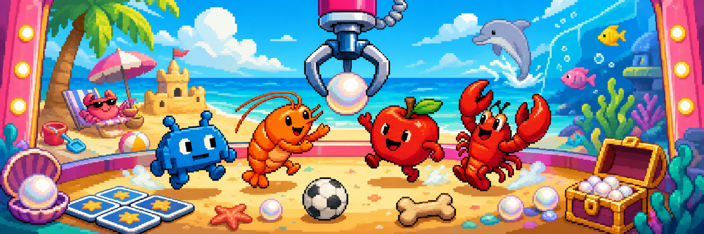

<p align="center">
  
</p>

# Clawparty

Clawparty is a tiny browser party game where four weird little contestants sprint through a six-round gauntlet of arcade minigames. It is built with Phaser 3, TypeScript, and Vite, with touch controls first and keyboard controls as a fallback.

The current build includes Pearl Panic, Goal Rush, Beret Trace, Bone Nap, Critter Count, and Tile Tide.

## Play Locally

```bash
npm install
npm run dev
```

Vite will print the local URL. Open it in a browser, or use your phone on the same network for the intended touch-control feel.

## Scripts

```bash
npm run dev      # start the Vite dev server
npm run typecheck # run the TypeScript checker
npm run build    # create a production build
npm run preview  # preview the built app locally
```

## Controls

Touch devices use the on-screen joystick and action button.

Keyboard fallback:

- Move: `WASD` or arrow keys
- Action: `Space` or `Enter`

## Game

- Four contestants: Invado, Shrimpy, Pip, and Lobstar
- One human player against three CPU opponents
- Six quick minigames per party
- Randomized CPU tiers for different chaos levels
- Main-menu minigame picker for practicing a single round
- Round results, crowns, and final party standings
- Local party-progress restore for interrupted sessions

## Minigames

- **Pearl Panic**: carry pearls back to your tidepool.
- **Goal Rush**: take turns aiming and shooting while the keeper tries to stop the ball.
- **Beret Trace**: trace shapes quickly and cleanly.
- **Bone Nap**: steal bones, then freeze when the dog wakes.
- **Critter Count**: watch the beach and count every critter that passes.
- **Tile Tide**: remember the safe colors and stand on the right tile.

## Project Layout

```text
.
├─ docs/
│  └─ clawparty-banner.png
├─ public/
│  └─ assets/sprites/
├─ src/
│  ├─ game/types.ts
│  ├─ scenes/ClawpartyScene.ts
│  ├─ ui/controls.ts
│  ├─ main.ts
│  └─ styles.css
├─ index.html
├─ package.json
└─ vite.config.ts
```

## Assets

The game uses project-local generated pixel-art sprites and background assets under `public/assets/sprites/`. No third-party starter-pack art assets are required.

The README banner at `docs/clawparty-banner.png` was generated for this open-source version of the project.

## License

MIT. See [LICENSE](LICENSE).

## Credits

This repository was originally bootstrapped from the Vibe Jam Starter Pack / VibeGameDev template. The starter-pack scaffolding and unrelated sample projects have been removed so this repo now focuses on Clawparty.
