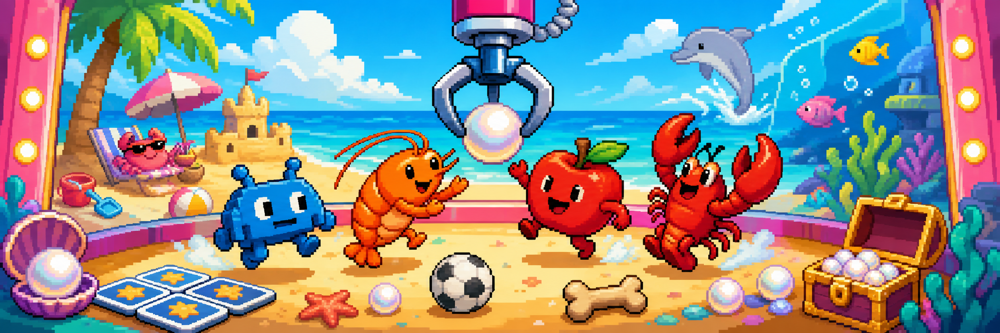

<p align="center">
  
</p>

# Clawparty

Clawparty is a tiny browser party game where four weird little contestants sprint through a six-round gauntlet of arcade minigames. It is plain JavaScript drawn on the browser's own 2D canvas, with touch controls first and keyboard controls as a fallback.

The current build includes Pearl Panic, Goal Rush, Beret Trace, Bone Nap, Critter Count, and Tile Tide.

## Play Locally

There is nothing to install or build. Serve the folder with any static file server, for example:

```bash
python3 -m http.server 8000 --bind 127.0.0.1
```

Then open http://127.0.0.1:8000 in a browser. To try the touch controls on a phone on the same network, bind the server to your computer's network address instead and open that address on the phone.

The game is made of ES modules, so it needs to be served over HTTP; opening `index.html` straight from disk will not load them.

## Stack

- HTML and CSS for the menus, HUD and touch controls (`index.html`, `src/styles.css`).
- The browser's 2D canvas for the arena, drawn every frame with `requestAnimationFrame` and the real time between frames, so it plays the same at 60 and 120 Hz, and sharp on high-density screens.
- Plain JavaScript ES modules with JSDoc types; an editor with TypeScript support checks them without a build step.

Clawparty has no dependencies: no packages, no bundler, no build step.

## Controls

Touch devices use the on-screen joystick and action button.

Keyboard fallback:

- Move: `WASD` or arrow keys
- Action: `Space` or `Enter`

## Game

- Four contestants: Invado, Shrimpy, Pip, and Lobstar
- One human player against three CPU opponents
- Six quick minigames per party
- Randomized CPU tiers for different chaos levels
- Main-menu minigame picker for practicing a single round
- Round results, crowns, and final party standings
- Local party-progress restore for interrupted sessions

## Minigames

- **Pearl Panic**: carry pearls back to your tidepool.
- **Goal Rush**: take turns aiming and shooting while the keeper tries to stop the ball.
- **Beret Trace**: trace shapes quickly and cleanly.
- **Bone Nap**: steal bones, then freeze when the dog wakes.
- **Critter Count**: watch the beach and count every critter that passes.
- **Tile Tide**: remember the safe colors and stand on the right tile.

## Project Layout

```text
.
├─ assets/sprites/          pixel-art sprites and backgrounds
├─ docs/
│  └─ clawparty-banner.png
├─ src/
│  ├─ game/types.js         shared JSDoc types
│  ├─ lib/draw.js           shapes, outlined text and images on the canvas
│  ├─ lib/loop.js           frame loop, game clock, canvas sizing
│  ├─ lib/math.js           random and number helpers
│  ├─ scenes/ClawpartyScene.js  the game: rounds, minigames, CPUs, drawing
│  ├─ ui/controls.js        joystick, action button and keyboard
│  ├─ main.js
│  └─ styles.css
└─ index.html
```

## Assets

The game uses project-local generated pixel-art sprites and background assets under `assets/sprites/`. No third-party starter-pack art assets are required.

The README banner at `docs/clawparty-banner.png` was generated for this open-source version of the project.

## License

MIT. See [LICENSE](LICENSE).

## Credits

This repository was originally bootstrapped from the Vibe Jam Starter Pack / VibeGameDev template. The starter-pack scaffolding and unrelated sample projects have been removed so this repo now focuses on Clawparty.
